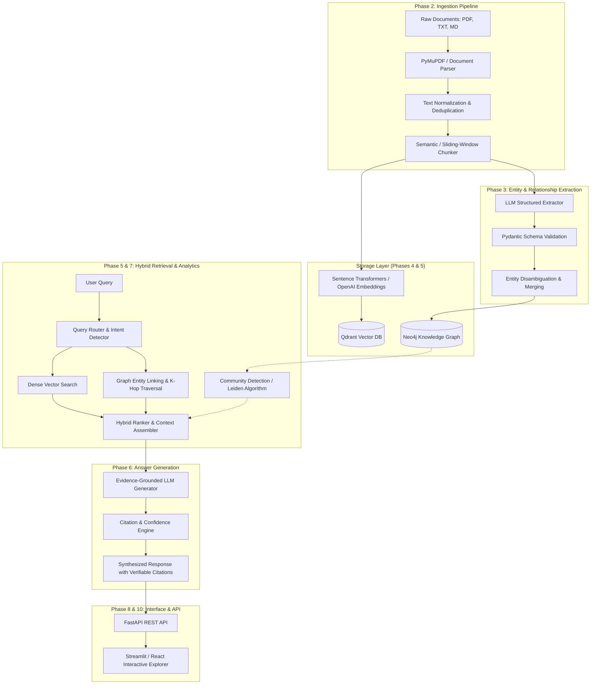

<div align="center">

# 🧠 GraphRAG Knowledge System

### AI-Powered Enterprise Knowledge System with Multi-Hop Relational Reasoning & Evidence Grounding

[](https://www.python.org/downloads/)
[](https://neo4j.com/)
[](https://qdrant.tech/)
[](https://opensource.org/licenses/MIT)
[](docs/roadmap.md)

</div>

---

## 🌟 Overview

Unlike basic RAG, which mainly retrieves isolated document chunks via semantic similarity, **GraphRAG Knowledge System** extracts entities, relations, and cross-document connections to construct an interconnected **Knowledge Graph**. By synthesizing graph path traversals with dense vector search, the system can reliably answer complex **multi-hop questions** and generate corpus-wide global summaries with verifiable citations.

### 🔬 Basic RAG vs. GraphRAG

| Capability | Basic Vector RAG | GraphRAG Knowledge System |
| :--- | :---: | :---: |
| **Point Lookup / Fact Retrieval** | ✅ Good | ✅ Excellent |
| **Multi-Hop Concept Traversal** | ❌ Fails (scattered chunks) | ✅ Traverses $k$-hop paths in Neo4j |
| **Corpus-Wide Global Questions** | ❌ Fails (context window limit) | ✅ Hierarchical Community Summaries |
| **Relational Provenance** | ❌ Unstructured text chunks | ✅ Verified node/edge citation pointers |
| **Conflict & Indirect Link Detection**| ❌ Weak | ✅ Graph Path Analysis |

---

## 📐 System Architecture



---

## 🗺️ 10-Phase Roadmap & Delivery Tracker

Each phase is developed, validated, and pushed sequentially as a dedicated milestone:

- [x] **Phase 1 — Project Planning & Architecture**
  - Problem statement, use cases & niche corpus definition (AI Research & Agent Systems)
  - Complete modular architecture, directory layout, and Pydantic domain models
  - REST API specifications and `.env.example` configurations
- [ ] **Phase 2 — Document Ingestion Pipeline**
  - PyMuPDF parser, TXT/Markdown loader, text cleaning, and token-aware sliding window chunking
- [ ] **Phase 3 — Entity & Relationship Extraction**
  - Structured LLM extraction, schema validation, entity normalization, and evidence linking
- [ ] **Phase 4 — Knowledge Graph Construction**
  - Neo4j graph engine, node/edge constraints, Cypher queries, and graph builder
- [ ] **Phase 5 — Vector Search & Hybrid Retrieval**
  - Qdrant vector database, embedding generation, and hybrid reciprocal rank fusion
- [ ] **Phase 6 — GraphRAG Answer Generation**
  - Multi-hop reasoning pipeline, inline citations `[DocID:ChunkID]`, and uncertainty fallback
- [ ] **Phase 7 — Advanced Graph Intelligence**
  - Community detection (Leiden/Louvain), global corpus summaries, and path discovery
- [ ] **Phase 8 — Frontend & Knowledge Explorer**
  - Streamlit web UI with interactive graph network explorer (PyVis) and document manager
- [ ] **Phase 9 — Evaluation, Testing & Security**
  - Automated benchmark (GraphRAG vs. Vector RAG), hallucination tests, and security hardening
- [ ] **Phase 10 — Deployment & Production Readiness**
  - FastAPI production backend, Docker Compose multi-service setup, and demo walkthrough

---

## 📂 Project Directory Structure

```text
GraphRAG-Knowledge-System/
├── docs/
│   ├── architecture.md       # Complete architectural specification & diagram
│   ├── api_spec.md           # REST API endpoints specification
│   └── roadmap.md            # Master 10-phase development tracker
├── src/
│   ├── core/                 # Configuration, logging, and Pydantic models
│   ├── ingestion/            # Phase 2: Document loaders, parsers, chunkers
│   ├── extraction/           # Phase 3: Structured entity & relation extractors
│   ├── graph/                # Phase 4: Neo4j client, Cypher queries, graph builder
│   ├── vector/               # Phase 5: Qdrant client and embedding engine
│   ├── retrieval/            # Phase 5: Hybrid retriever and rank fusion
│   ├── generation/           # Phase 6: GraphRAG reasoning and citation grounder
│   ├── analytics/            # Phase 7: Community detection and global summaries
│   └── api/                  # Phase 10: FastAPI REST routes
├── data/
│   └── raw/sample_papers/    # Benchmark corpus for AI research & GraphRAG
├── tests/                    # Unit and integration test suite
├── .env.example              # Environment variables template
├── .gitignore                # Git ignore rules
├── requirements.txt          # Python dependencies
├── pyproject.toml            # Project packaging specification
└── README.md                 # Project README
```

---

## 🚀 Quickstart

### 1. Clone & Set Up Environment

```bash
git clone https://github.com/ftarunnnn/GraphRAG-Knowledge-System.git
cd GraphRAG-Knowledge-System

# Create virtual environment
python -m venv .venv
# Activate on Windows:
.venv\Scripts\activate
# Activate on Linux/macOS:
source .venv/bin/activate

# Install dependencies
pip install -r requirements.txt
```

### 2. Configure Environment

```bash
cp .env.example .env
# Edit .env with your Neo4j, Qdrant, and LLM credentials
```

### 3. Run Phase 1 Tests

```bash
pytest tests/test_phase1.py -v
```

---

## 📚 References & Inspirations
- [Microsoft GraphRAG](https://github.com/microsoft/graphrag)
- [Neo4j GraphAcademy](https://graphacademy.neo4j.com/)
- [Qdrant Vector Database Documentation](https://qdrant.tech/documentation/)