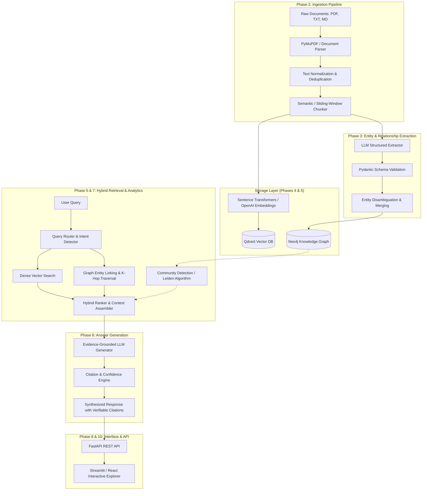

# GraphRAG Knowledge System — Architecture & System Design Specification

## 1. Executive Summary & Problem Statement

Standard Retrieval-Augmented Generation (RAG) relies primarily on dense vector embeddings to retrieve top-$k$ unstructured text passages based on semantic similarity. While effective for localized factual retrieval, standard RAG struggles with:
1. **Multi-Hop Reasoning**: Questions requiring traversal across disparate documents (e.g., *"How does entity A connect through intermediate concept B to affect entity C?"*).
2. **Corpus-Wide Global Summaries**: Questions asking about high-level themes (e.g., *"What are the primary architectural bottlenecks across all discussed agent systems?"*).
3. **Implicit & Structural Relationships**: Vector representations cannot reliably capture explicit directed relationships, dependencies, hierarchies, and confidence metadata.

**GraphRAG Knowledge System** solves these limitations by combining:
- **Neo4j Knowledge Graph**: Explicit nodes (Entities), edges (Relationships), confidence scores, and source document lineages.
- **Qdrant Vector Database**: High-performance semantic similarity search across chunk embeddings.
- **Hybrid Retrieval & Reranker**: Graph-informed neighborhood traversal merged with dense vector retrieval.
- **Evidence-Grounded Generation**: Multi-hop path synthesis with strict inline citation attribution.

---

## 2. Niche Corpus Selection

**Target Domain**: **AI Research & Modern Autonomous Agent Architectures**
- Topics covered:
  - Transformer Architectures & Attention Mechanisms
  - Graph-Augmented Generation (GraphRAG, HippoRAG, Knowledge Graphs)
  - Vector Indexing & Approximate Nearest Neighbors (HNSW, IVF)
  - Memory Systems in Multi-Agent Frameworks
  - Context Caching, Tool Calling, and Verification Loops
- Why this niche?
  - Dense inter-document citations and conceptual dependencies.
  - Rich variety of entities: Models, Researchers, Techniques, Benchmarks, Datasets, Organizations.
  - Demonstrates multi-hop questions where pure vector retrieval fails (e.g., *"Which memory mechanisms discussed in Agent papers rely on the indexing strategies proposed in Vector search papers?"*).

---

## 3. High-Level Architecture Diagram

---

## 4. Subsystem Components & Responsibilities

| Subsystem | Responsibilities | Key Technologies |
| :--- | :--- | :--- |
| **Ingestion (`src/ingestion`)** | Document loading, text extraction, cleaning, metadata preservation, chunking. | PyMuPDF, Pydantic, Tiktoken |
| **Extraction (`src/extraction`)** | Structured extraction of entities, relationships, confidence, and source chunk links. | Instructor / OpenAI Structured Outputs, Pydantic |
| **Graph Store (`src/graph`)** | Graph schema constraints, Cypher query execution, node/edge insertion, merging duplicates. | Neo4j, Cypher, NetworkX |
| **Vector Store (`src/vector`)** | Embedding generation, Qdrant collection management, hybrid indexing, similarity search. | Qdrant, SentenceTransformers |
| **Retrieval (`src/retrieval`)** | Query classification, entity extraction from prompt, $k$-hop graph traversal, fusion ranking. | Reciprocal Rank Fusion (RRF), Neo4j |
| **Generation (`src/generation`)** | Multi-hop reasoning prompt templates, LLM synthesis, strict citation validation. | LangChain / Direct LLM Client |
| **Analytics (`src/analytics`)** | Community detection (Leiden/Louvain), global summaries, graph metric analysis. | NetworkX, Neo4j Graph Data Science |
| **API & Web (`src/api`, `src/ui`)** | REST endpoints, interactive graph visualization, upload management, answer inspection. | FastAPI, Streamlit, PyVis / Cytoscape |

---

## 5. Data Models & Schemas

### Entity Node Schema
- `id`: Unique identifier (normalized slug, e.g., `transformer_architecture`)
- `name`: Human-readable name (e.g., `"Transformer Architecture"`)
- `type`: Category (`CONCEPT`, `MODEL`, `ORGANIZATION`, `METHOD`, `BENCHMARK`, `PAPER`)
- `description`: Unified description synthesized across occurrences
- `source_chunk_ids`: List of chunk IDs where this entity appeared
- `created_at`: Ingestion timestamp

### Relationship Edge Schema
- `source_id`: Source Entity ID
- `target_id`: Target Entity ID
- `relation_type`: Normalized relation (e.g., `UTILIZES`, `EXTENDS`, `EVALUATED_ON`, `AUTHORED_BY`, `CONTRASTS_WITH`)
- `description`: Description of how source and target interact
- `weight`: Confidence score $(0.0 - 1.0)$
- `source_chunk_id`: Document chunk providing direct textual evidence
- `evidence_text`: Direct verbatim snippet validating the relationship

---

## 6. End-to-End Query Execution Pipeline

1. **Query Ingestion**: The user asks a question via API or UI.
2. **Intent Analysis**:
   - `DIRECT_LOOKUP`: Standard vector search is sufficient.
   - `MULTI_HOP`: Requires extracting query entities, matching against Neo4j, and walking 1-3 hops.
   - `GLOBAL_SUMMARY`: Requires community summaries and global aggregation across clusters.
3. **Retrieval Fusion**:
   - Vector retriever fetches Top-$K$ relevant chunks ($S_{vector}$).
   - Graph retriever extracts seed entities from question, queries Neo4j for 1-hop and 2-hop subgraphs ($S_{graph}$).
   - Merged context with deduplication and source chunk cross-referencing.
4. **Prompt Construction**: Structured prompt with ground-truth facts, relationship triples, and raw source passages.
5. **LLM Generation**: Model generates structured response with `[Citation: DocID#ChunkID]` citations.
6. **Uncertainty Fallback**: If retrieved confidence falls below threshold, system outputs explicit uncertainty warning instead of hallucinating.
